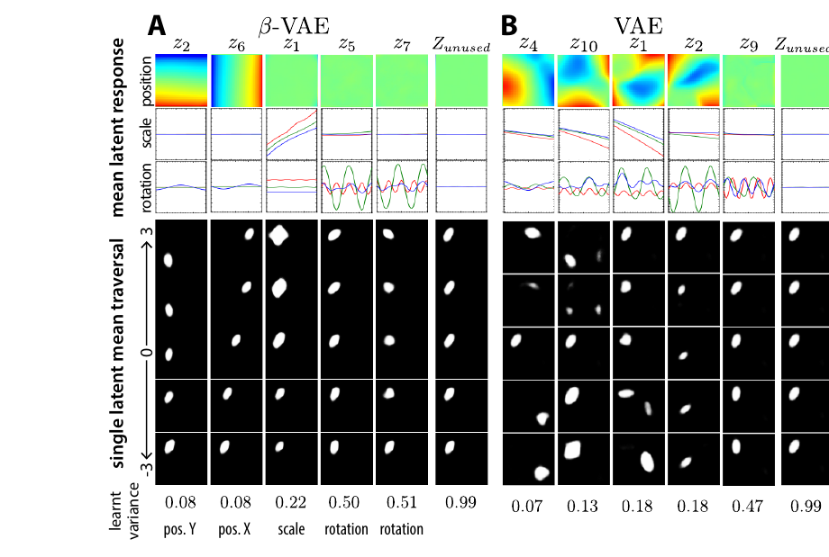
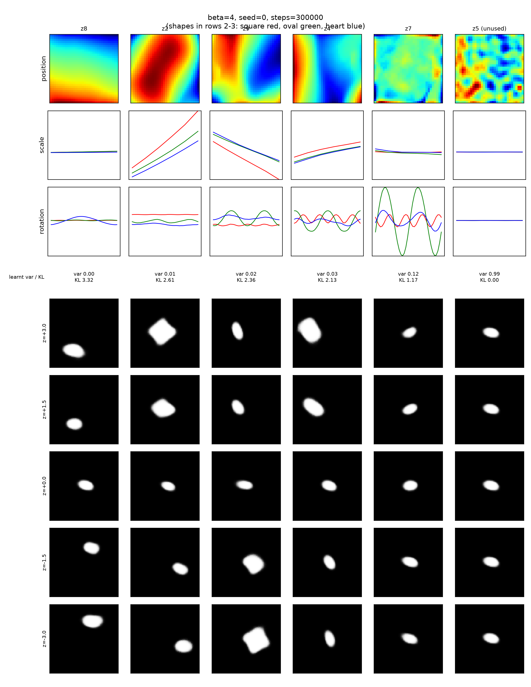
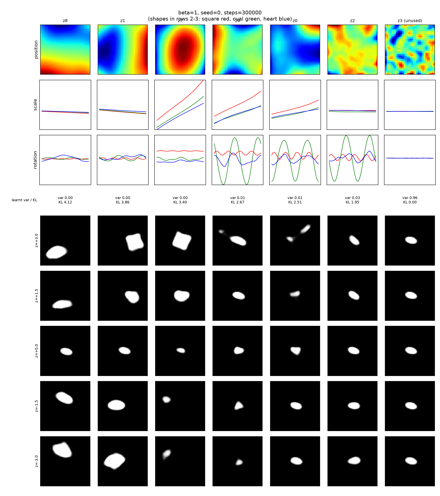
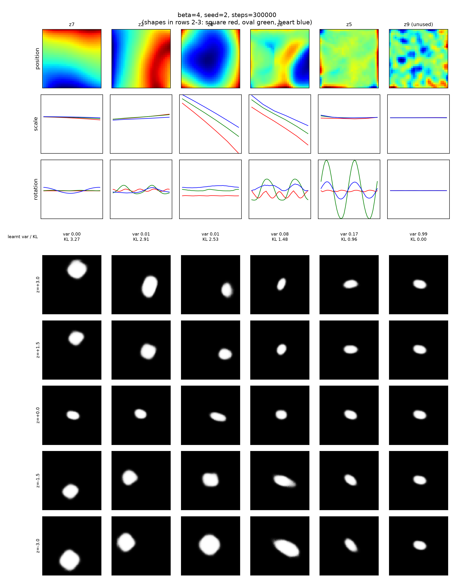

# β-VAE: Learning Basic Visual Concepts with a Constrained Variational Framework (Higgins et al., ICLR 2017): reproduction of Figure 7A/B

Preston Horne, CS 6362 Assignment 2

## 1. Problem statement and method

### Setting

Each image is a flattened binary vector $x \in \{0,1\}^N$ with $N = 4096$ (a 64×64 white sprite on a black background). dSprites contains all 3·6·40·32·32 = 737,280 combinations of $K = 5$ generative factors $v = (v_1,\dots,v_K)$: shape (square, oval, heart), scale (6 values in [0.5, 1]), rotation (40 values in [0, 2π]), and position X and Y (32 values each in [0, 1]). The file's sixth factor, colour, is constant. Let $D = \{x^{(i)}\}_{i=1}^{737{,}280}$ be the dataset.

The paper writes the data as $D = \{X, V, W\}$: images, conditionally independent factors $v$ with $\log p(v\mid x) = \sum_k \log p(v_k\mid x)$, and conditionally dependent factors $w$, with $x = \text{Sim}(v, w)$. dSprites has no $w$: the paper (§4.2) says it "contains no confounding factors apart from its five independent data generative factors", and the images are rendered without noise. Training uses only the images; $v$ is used only to draw Fig. 7.

The model has an encoder $q_\phi(z\mid x) = \mathcal N(\mu_\phi(x), \mathrm{diag}\,\sigma_\phi^2(x))$ with parameters $\phi$ over latents $z = (z_1,\dots,z_M) \in \mathbb R^M$, $M = 10$; a decoder $p_\theta(x\mid z)$, a product of Bernoullis over pixels, with parameters $\theta$; an isotropic unit-Gaussian prior $p(z) = \mathcal N(0, I)$; and a weight $\beta \ge 0$ on the KL term (β = 4 for Fig. 7A, β = 1 for Fig. 7B).

### Problem

Learn, from $x$ alone, an encoder whose latents are **disentangled**: in the paper's words (citing Bengio et al., 2013), "single latent units are sensitive to changes in single generative factors, while being relatively invariant to changes in other factors". With $M = 10 > K = 5$, we would also like the $M - K$ spare latents to carry no information (KL ≈ 0).

### Objective

Maximise the expected log-likelihood, but cap how much information the posterior may carry by keeping it close to the prior:

$$ \max_{\theta,\phi}\ \mathbb{E}_{x\sim D}\Big[\mathbb{E}_{q_\phi(z\mid x)}[\log p_\theta(x\mid z)]\Big] \quad \text{s.t.}\quad D_{KL}\big(q_\phi(z\mid x)\,\|\,p(z)\big) < \epsilon . $$

The Lagrangian under the KKT conditions, with multiplier $\beta \ge 0$, is
$\mathcal F = \mathbb{E}_q[\log p_\theta(x\mid z)] - \beta\,(D_{KL}(q_\phi(z\mid x)\|p(z)) - \epsilon)$.
Because $\beta\epsilon \ge 0$, dropping it gives a lower bound on $\mathcal F$, the β-VAE objective (paper Eq. 4):

$$ \mathcal{L}_\beta(\theta,\phi;x) = \mathbb{E}_{q_\phi(z\mid x)}[\log p_\theta(x\mid z)] - \beta\, D_{KL}\big(q_\phi(z\mid x)\,\|\,p(z)\big). $$

At β = 1 this is the standard VAE evidence lower bound (ELBO). For a diagonal Gaussian posterior the KL splits across latents,

$$ D_{KL} = \sum_{j=1}^{M} \tfrac12\big(\mu_j^2 + \sigma_j^2 - \log\sigma_j^2 - 1\big), $$

so each latent's information cost can be read off separately. Gradients pass through the sampling step with the reparameterization $z = \mu + \sigma\odot\varepsilon$, $\varepsilon\sim\mathcal N(0, I)$.

### Intuition

Read the KL term as the price of sending information through $z$: every nat stored in latent $j$ costs β nats of objective. With β > 1, information is expensive, so the model keeps only the channels that buy the most reconstruction and lets the rest collapse to the prior ($\mu_j \approx 0$, $\sigma_j \approx 1$, KL ≈ 0). The paper credits the isotropic prior with pushing the surviving channels toward independent factors. An isotropic prior is rotation-invariant, though, so it cannot pick out coordinate axes by itself. What can is the diagonal (mean-field) posterior: a factor smeared across several coordinates pays KL in each of them, so storing each independent factor in its own coordinate is cheapest (Rolínek et al., 2019). Too much pressure discards factors (the paper says those with small pixel-space effects go first) and blurs reconstructions.

### What happens to $\mathcal L_\beta$ for β > 1? For β < 1?

Write $\mathcal L_\beta = \text{ELBO} - (\beta - 1)\,D_{KL}$.

For **β > 1**, $\mathcal L_\beta \le \text{ELBO} \le \log p(x)$, a *looser* lower bound. The extra penalty trades reconstruction for a more compressed code, closer to the factorised prior. This favours disentanglement, at the price of reconstruction quality and, at high β, of losing factors altogether.
For **β < 1**, $\mathcal L_\beta \ge \text{ELBO}$, so it is no longer guaranteed to bound $\log p(x)$. The posterior is under-regularised: more latents carry information, reconstructions sharpen, and the pressure toward axis-aligned factors weakens. As β → 0 the KL term vanishes and the model approaches a plain autoencoder, with no push toward disentanglement and a latent space that is poor for sampling.

### How are the latents in Figure 7 ordered, and how is each traversal generated?

**Order.** Columns are sorted by each latent's **learnt Gaussian variance**, $\sigma_j^2(x)$ averaged over the dataset (the bottom row of the paper's figure), smallest first. Informative latents have small variance; unused ones sit near 1 and are shown once as "$Z_{unused}$".

**Response rows.** Row 1 is the mean $\mu_j$ as a 32×32 map over (pos X, pos Y), averaged over shape, scale and rotation. Rows 2–3 plot mean $\mu_j$ against scale (averaged over rotation and position) and against rotation (averaged over scale and position), one curve per shape: square red, oval green, heart blue.

**Traversal rows.** Encode one seed image $x$. Hold all other latents at their posterior means $\mu(x)$, set the traversed latent to 5 evenly spaced values from +3 to −3 (±3 prior standard deviations around the prior mean 0), decode each code, and show the Bernoulli means. Our figures print the learnt variance (and KL) above the traversal rows instead of below them.

### Choices we made

**Seeds per β: three (0, 1, 2) for each of β = 4 and β = 1**, with identical code and hyperparameters. One seed can show that the pipeline *can* produce a disentangled code, and that β moves capacity in the expected direction (fewer active latents, lower KL, worse reconstruction). One seed cannot separate a systematic β effect from run-to-run variation. That variation is large for this method: the paper's own metric protocol (Appendix A.4) trains 10 seeds, scores each 3 times and discards the bottom 50% of the 30 scores. Three seeds show the spread roughly; they are not enough for a statistical test.

**Settings the paper does not state.** Batch size 64 and 300k Adagrad steps (≈26 epochs). Table 1 gives the encoder as FC 1200-1200 with ReLU and the decoder as FC 1200-1200-1200-4096 with "Tanh" and a Bernoulli likelihood; we read this as tanh hidden units and a sigmoid (logit) output. Learnt variance is the dataset mean of $\sigma_j^2$. A latent counts as "unused" when its dataset-mean KL is at most 0.1 nats. Every run uses the same traversal seed image, dataset index 305711 (drawn with `RandomState(0)`). There is no train/test split; like the paper's Fig. 7, all statistics are over the full dataset.

## 2. Reproduction

### LLM, conversation and code

**LLM:** Claude Sonnet 5.5 (Medium effort), claude.ai chat interface. **Conversation:** the chat ran in Claude's incognito mode, which cannot be shared. With the instructor's approval (2026-10-19) of markdown transcripts for incognito chats, we submit the full transcript instead, copied message by message: [`llm_transcript.md`](https://github.com/prestonmhorne/cs6362-assignment2/blob/main/betavae/llm_transcript.md). The Phase 1 prompt is in [`phase1_prompt.md`](https://github.com/prestonmhorne/cs6362-assignment2/blob/main/betavae/phase1_prompt.md). **Code:** https://github.com/prestonmhorne/cs6362-assignment2/tree/main/betavae. `phase1.py` is the LLM's code, unmodified, and is the only model, training, evaluation and plotting code. `phase3_seeds.sh` reruns it for seeds 0–2, and the notebook `reproduce_figure7.ipynb` calls it and shows the outputs. Per-run outputs are in `phase1_runs/beta{4,1}_seed{0,1,2}/` (`fig7.png`, `metrics.json`, `train_log.csv`), and `phase1_runs/summary_all_runs.csv` collects them.

### Original and reproduced figures

*Original (A: β-VAE, β = 4; B: VAE, β = 1):*

*Reproduction, seed 0, β = 4 then β = 1. Seed 0 was fixed before training, not picked afterwards. All six figures are in `phase1_runs/beta*_seed*/fig7.png` and in the notebook. The suptitle overlaps some column labels (a cosmetic bug in the LLM's plotting code); each run's latent order is also in `metrics.json` (`latent_order_by_var_ascending`).*

*β = 4, seed 2, the run closest to the paper's Fig. 7A:*

### Results over seeds

Numbers are from `phase1_runs/summary_all_runs.csv`. Reconstruction NLL is the dataset-mean Bernoulli negative log-likelihood with $z$ sampled from the posterior; KL is the dataset-mean total KL. The last column is our visual reading of each `fig7.png`; we did not compute a quantitative disentanglement score.

| β | seed | recon NLL (nats) | total KL (nats) | active latents | visual reading of fig7.png |
|--|--|---|---|---|----------------|
| 4 | 0 | 65.50 | 11.58 | 5 | Y (z8) fairly clean; rotation (z7) clean; X mixed with rotation and scale; scale split across z2 and z9, both mixed with position |
| 4 | 1 | 61.40 | 12.03 | 5 | only scale (z3) fairly clean, though its position map is a central blob and its traversal also moves and thins the object; the other four mix position, scale and rotation |
| 4 | 2 | 70.69 | 11.16 | 5 | Y (z7) and X (z2) each dominate one latent, though their ±3 traversals also change size and shape and X drifts in Y; scale (z8) flat in rotation but with a bowl-shaped position map; z6 mixes scale and rotation (where the paper has a second rotation latent); rotation (z5) clean |
| 1 | 0 | 38.58 | 18.52 | 6 | Y and X fairly clean; scale in one latent with a bowl-shaped position map; rotation spread over three latents, one near-pure (z2), two mixed with scale and shape |
| 1 | 1 | 39.35 | 18.62 | 6 | nothing clean: blob- or X-shaped position maps, three latents mix rotation with scale and position, traversals change shape, one produces two blobs |
| 1 | 2 | 37.70 | 18.58 | 6 | X clean; the rest mix scale with position and rotation with shape |
| **4** | mean ± sd | **65.86 ± 4.65** | **11.59 ± 0.43** | **5 ± 0** | |
| **1** | mean ± sd | **38.54 ± 0.83** | **18.57 ± 0.05** | **6 ± 0** | |

Standard deviations are sample SDs over n = 3 seeds (computed from the per-run rows); the training log prints population SDs.

### Phases, failures and corrections

#### Phase 1: paper and prompt to the LLM

We gave the LLM the paper PDF and the prompt in `phase1_prompt.md`, which asked it to summarise the setup, list what the paper leaves unstated, and write a runnable PyTorch implementation without searching the web or using existing code. Its setup summary matched the paper on every stated detail: the Table 1 architecture, 10 latents, Adagrad with lr 1e-2, Bernoulli likelihood, the Eq. 4 objective, and the Fig. 7 layout and ordering. It flagged its own choices (batch size, step count, the reading of "Tanh … Bernoulli", the unused-latent threshold) and noted that one seed cannot capture the seed variance implied by the paper's protocol. It also recommended a short smoke test; the one we ran (2000 steps per β, `runs_smoke/`) already moved in the right direction (β = 4: 4 active latents, KL 9.0; β = 1: 9 active, KL 16.1).

#### Phase 2: review of the LLM's output

We checked the LLM's setup and figure construction against the paper (`phase2_review.md`); both matched Table 1, Eq. 4 and the Fig. 7 caption. The full 300k-step seed 0 runs reproduce the β effect on the summary statistics. Qualitatively, however, two things did not match. Disentanglement at β = 4 was only partial: scale is split across two latents, both mixed with position, and X is mixed with rotation and scale, whereas the paper's 7A has one latent each for X, Y and scale (plus two for rotation). And the β = 1 model was cleaner than 7B: position is fairly clean and scale sits in one latent (though with a bowl-shaped position map), and the entanglement shows mainly in rotation and shape. With one seed per β we could not tell whether these were seed variance or a systematic gap. We also noted the cosmetic overlap of suptitle and column titles.

#### Phase 3: correction attempt and diagnosis

Since the code matched the paper's stated setup, the hypothesis to test was seed variance. We trained seeds 1 and 2 for both β with the **unchanged** Phase 1 code (`--seed_start 0 --num_seeds 3` in `phase3_seeds.sh`; seed 0 was reloaded, not retrained). Results are in the table above.

**Capacity is consistent across seeds.** Every β = 4 run has 5 active latents and every β = 1 run has 6. KL is 11.59 ± 0.43 vs 18.57 ± 0.05 nats, reconstruction NLL 65.86 ± 4.65 vs 38.54 ± 0.83. The β effect on capacity is systematic.

**Disentanglement quality varies a lot across seeds, especially at β = 4.** Seed 2 comes closest to Fig. 7A: Y, X and rotation each have their own latent, with the caveats in the table. Scale is still split, though: z8 and z6 have equally steep scale curves, and z6 also responds to rotation. Seed 0 is partial and seed 1 mostly entangled. So part of the Phase 2 gap at β = 4 was seed variance (seed 2 separates X, Y and rotation), but none of our three seeds puts scale in a single latent as 7A does.

**β = 1 is consistently more entangled than the best β = 4 run.** In every β = 1 seed rotation is spread over three latents, at most one of them near-pure (like 7B's z9). Seed 1 is as entangled as 7B; seeds 0 and 2 keep one or more position or scale latents clean.

**Reconstruction vs disentanglement.** Within β = 4 the cleanest run (seed 2) has the worst reconstruction (70.69 vs 61.40–65.50 nats). That fits the paper's trade-off, but with n = 3 it is anecdotal.

**Remaining mismatches, diagnosed from the training logs.** Two quantitative differences remain. First, our informative latents have smaller learnt variances than Fig. 7's: 0.002–0.17 at β = 4 (paper 0.08–0.51) and 0.0004–0.026 at β = 1 (paper 0.07–0.47). Second, every β = 1 seed has 6 active latents where Fig. 7B shows 5. The training logs (`train_log.csv`, which record per-latent KL averaged over each block of 1000 steps) show that training had not converged at 300k steps. Total KL was still rising in every run (β = 1 seed 0: 17.4 → 18.1 → 18.5 nats at 100k/200k/300k steps; β = 4 seed 2: 9.8 → 10.4 → 11.1) and reconstruction still falling (β = 1 seed 0: 52.5 → 43.7 → 38.7). Rising KL means posteriors still sharpening, consistent with our small learnt variances. Variances themselves were not logged during training, so this is indirect. Training length does not, however, explain 6 vs 5 latents at β = 1. Counting latents whose logged KL exceeds 0.1 nats, β = 1 never had fewer than six active latents after 18k, 1k and 11k steps in seeds 0, 1 and 2. At β = 4, by contrast, the count settled late in two seeds: a fifth latent stayed active only from ≈72k steps (seed 0) and ≈184k steps (seed 2). Seed 1 started with all 10 active and fell to 5 by 12k steps. Batch size, the other unstated setting, is untested because each change needs several multi-hour runs. We have not tested whether a longer or differently batched run would change which latents are informative or how they are ordered.

#### Phase 4: existing implementation

We found no code release from the authors; DeepMind's `dsprites-dataset` repo contains only the dataset and a loading notebook. There was nothing to compare against, so nothing was changed (`phase4.md`). We checked our data handling against that repo: same file, same keys, same factor sizes (1, 3, 6, 40, 32, 32).

`phase4.md` was committed (63069f7) before the Phase 3 seed results (1eb1dd4). These hashes are from our private working repo (see [`commit_history.md`](https://github.com/prestonmhorne/cs6362-assignment2/blob/main/commit_history.md)). The order is harmless here: no authors' code exists, and Phase 3 reuses the committed Phase 1 code unchanged (`phase1.py` is identical in both commits).

### Does the reproduction support the claim?

**What Fig. 7 offers as evidence.** A latent is disentangled if it responds to one factor and is flat in the others: a clean gradient (or flat map) in the row-1 position map, flat or monotone curves in rows 2–3, and a traversal that changes exactly one property of the object. Fig. 7A shows this at β = 4 for X, Y, scale and two rotation latents. Fig. 7B shows VAE latents whose position maps are blobs and whose traversals change several properties at once; the paper notes one exception, z9, which learnt rotation alone.

**Does our reproduction show the same difference?** Partly, and in the same direction. On *capacity* the difference is clear and seed-independent: β = 4 always uses 5 latents and ≈11.6 nats, β = 1 always 6 latents and ≈18.6 nats. On *disentanglement*, the best β = 4 run (seed 2) comes closest to 7A (X, Y and rotation separated, scale split over two latents), and every β = 1 run spreads rotation over three latents. But the contrast is weaker than the paper's two panels: one β = 4 seed (seed 1) is mostly entangled, and two β = 1 seeds keep position or scale clean. Our evidence supports the claim in distribution (the best β = 4 run is more disentangled than any β = 1 run, though no run fully matches 7A), not run by run. Fig. 7 is best read as a best case, consistent with the paper's discard-the-bottom-half metric protocol.

**Would increasing β further help?** The paper's §4.1–4.2 and Fig. 6 (right) show that it helps only up to a point. Past the best β (they normalise β by latent size over input size), the model drops factors with small pixel-space effects (in dSprites, plausibly rotation and shape) and reconstructions blur. Disentanglement first improves, then degrades as factors are discarded or merged. Our runs show the start of this trade-off: going from β = 1 to β = 4 costs 27.3 nats of reconstruction to save 7.0 nats of KL. We did not train β > 4, so this answer rests on the paper's evidence, not ours.

### Disclosures

The Phase 1 prompt asked the LLM not to search the web or use existing implementations. Web search was switched off in this chat, and the transcript shows no web search or tool use. No existing code was retrieved in Phases 1–3.

An IDE assistant (Claude Code, Claude Opus 5.5) saved the chat's code verbatim, ran training, and wrote the review notes (`phase2_review.md`, `phase4.md`). It wrote only harness scripts (the seed run queue, the notebook wrapper), none of the model, training, evaluation or plotting code. Claude Code wrote first drafts of the report text (Section 3 drafted from our reproduction results with the saved OpenReview reviews already in hand). We then rewrote the report ourselves, in conversation with Claude Code: on 2026-10-21 it restructured and revised the text at our request to follow the assignment rubric, rechecked every number against `metrics.json`, `summary_all_runs.csv` and `train_log.csv`, and an independent Claude Code agent fact-checked the result; we decided what the report says. Prompts are in [`claude_code_prompts.md`](https://github.com/prestonmhorne/cs6362-assignment2/blob/main/claude_code_prompts.md).

## 3. Critical review

### Summary of claims

The paper weights the VAE's KL term by β > 1, motivated as the multiplier of a capacity constraint, and claims this yields disentangled latents without supervision. It compares against VAE, InfoGAN and DC-IGN qualitatively (chairs, CelebA, 3D faces) and, on dSprites, quantitatively with a new supervised disentanglement metric.

### Strengths

The method adds one scalar to a standard VAE, so the effect of β is easy to isolate. The metric made disentanglement something one could score, and Locatello et al. (2019) later benchmarked it alongside others. The capacity effect reproduces: across three seeds, β = 4 always uses 5 active latents and 11.59 ± 0.43 nats of KL, while β = 1 always uses 6 latents and 18.57 ± 0.05 nats. None of our six runs diverged.

### Weaknesses and potential errors

#### 1. The constrained-optimisation derivation is not used in practice

β is set by hand, and the budget $\epsilon$ it corresponds to is never reported. Dropping $\beta\epsilon$ leaves a re-weighted ELBO, a looser bound on $\log p(x)$ for β > 1. The paper attributes the pressure toward independent latents to the isotropic prior, but an isotropic prior is rotation-invariant and cannot select axes; the diagonal posterior does (Rolínek et al., 2019). Our runs fit this reading: at β = 4 the capacity is reproducible (11.2–12.0 nats), but which factors land in which latents is not.

#### 2. Model selection needs supervision

β is chosen by eye or by the metric, which needs ground-truth factors. Within a fixed β the training objective does not help: it ranks our β = 4 seeds (NLL + 4·KL, lower is better) as seed 1 (109.5) < seed 0 (111.8) < seed 2 (115.3), the reverse of our visual ranking of disentanglement. With n = 3 this is only suggestive, but it matches Locatello et al. (2019): unsupervised model selection is unreliable.

#### 3. The metric protocol overstates reliability

Appendix A.4 discards the bottom 50% of the 30 metric scores "to control for the outlier results from the few experiments that diverged". A few diverged runs cannot account for half the scores. Our runs never diverged yet still varied widely in disentanglement (point 4), so the discard likely removes poorly disentangled runs too.

#### 4. Fig. 7 shows one model per β, and how it was chosen is not stated

Our β = 4 seeds range from mostly entangled (seed 1) to partial (seed 0) to closest to 7A (seed 2, with scale still split over two latents). At β = 1, seeds 0 and 2 keep position or scale clean, unlike 7B, while all three spread rotation over three latents. The β effect holds in distribution, not run by run.

#### 5. dSprites is favourable by construction

Its factors are independent and densely sampled, and Appendix A.8 shows disentanglement falling as sampling density drops. Later work found that up-weighting only the total-correlation part of the KL gives a better trade-off with reconstruction (Kim & Mnih, 2018; Chen et al., 2018).

### Overall

A simple, influential idea. The capacity effect is robust; the disentanglement claim holds as a best case, not reliably per run.

### Comparison with the OpenReview reviews (https://openreview.net/forum?id=Sy2fzU9gl)

The paper was accepted as a poster. The official reviewers rated it 7 (R1), 5 (R2) and 6 (R3), and a signed public review gave it 7.

#### Where we agree

R1 asked why the bottom 50% of scores is discarded (our point 3). R2 asked how β is chosen (point 2). R3 objected that the quantitative results use only 2D shapes and only the authors' metric, and asked whether dense sampling of the factors matters (point 5); the authors pointed to Appendix A.8. In other replies they also conceded that the model "can only learn to disentangle factors that are statistically independent in the data", giving CelebA's correlated age and gender as an example.

#### What they raised that we did not

R1 found the metric section hard to follow and asked for a comparison with cross-correlation. R2 noted the lack of log-likelihood results and that samples are less realistic than InfoGAN's, and asked why one should not simply reduce the latent dimension. R3 asked for more seeding images and whether they were seen in training (ours were, since we use no train/test split). The public review called the method a "toy" that does not scale to real data.

#### What we raised that they did not

No reviewer questioned the role of the isotropic prior (point 1), though R1 asked why very high β entangles, against the paper's own intuition. No one noted that Fig. 7 is an unexplained choice of one model per β (point 4), or that the objective cannot tell good seeds from bad ones (point 2). Our seeds also test two of the authors' replies. They reported no "strong variations" across seeds; this holds for capacity but not for disentanglement quality. They attributed the discard to diverged runs; ours did not diverge and still differed.

## References

- Bengio, Y., Courville, A., Vincent, P. (2013). Representation learning: A review and new perspectives. IEEE TPAMI.
- Chen, R. T. Q., Li, X., Grosse, R., Duvenaud, D. (2018). Isolating sources of disentanglement in variational autoencoders. NeurIPS.
- Higgins, I. et al. (2017). β-VAE: Learning basic visual concepts with a constrained variational framework. ICLR.
- Kim, H., Mnih, A. (2018). Disentangling by factorising. ICML.
- Locatello, F. et al. (2019). Challenging common assumptions in the unsupervised learning of disentangled representations. ICML.
- Rolínek, M., Zietlow, D., Martius, G. (2019). Variational autoencoders pursue PCA directions (by accident). CVPR.
