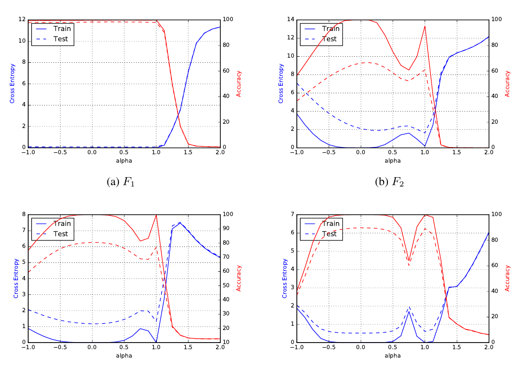
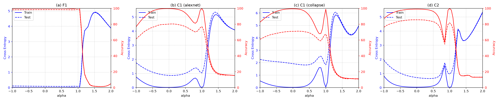

# On Large-Batch Training for Deep Learning: Generalization Gap and Sharp Minima (Keskar et al., ICLR 2017): reproduction of Figure 3 (F1, C1, C2)

Preston Horne, CS 6362 Assignment 2

## 1. Problem statement and method

**Setting.** Training data $\{(a_i, b_i)\}_{i=1}^{M}$, network parameters $x \in \mathbb{R}^n$, per-example loss $f_i(x) = \ell(h(a_i; x), b_i)$ (cross-entropy). Training minimizes the empirical risk

$$ f(x) = \frac{1}{M}\sum_{i=1}^{M} f_i(x). $$

A stochastic gradient method samples a batch $B_k \subset \{1,\dots,M\}$ and steps with step size $\eta_k$ (we keep $\alpha$ for the interpolation coefficient below)

$$ x_{k+1} = x_k - \eta_k \frac{1}{|B_k|}\sum_{i\in B_k}\nabla f_i(x_k). $$

In the paper, *small-batch* (SB) means $|B_k| = 256$ and *large-batch* (LB) means $|B_k| = 0.1M$. Both use ADAM.

**Claim.** LB methods reach similar training loss but worse test accuracy (a *generalization gap*, Table 2). The authors attribute this to LB converging to **sharp minimizers**, where $f$ rises steeply in some directions (large positive eigenvalues of $\nabla^2 f$). SB tends to reach **flat minimizers**, where $f$ varies slowly over a wide neighbourhood. The intuition: a flat minimizer can be described with low precision (MDL argument). Fig. 1 also sketches the test function as a shifted copy of the training function, so a shift costs little at a flat minimum and a lot at a sharp one. The explanation offered for why SB ends up flat: minibatch gradient noise (whose variance, in our gloss, scales as $1/|B_k|$) pushes the iterate out of narrow basins.

**Figure 3 (what we reproduce).** Let $x_s^\star$ and $x_\ell^\star$ be the SB and LB solutions. The *parametric plot* evaluates the loss and accuracy along the line through both points:

$$ g(\alpha) = f\big(\alpha\, x_\ell^\star + (1-\alpha)\, x_s^\star\big), \quad \alpha \in [-1, 2], $$

so $\alpha=0$ is the SB minimizer and $\alpha=1$ the LB minimizer. Left axis: cross-entropy (train solid, test dashed). Right axis: classification accuracy. Sharpness shows up as asymmetry: $g$ grows much faster for $\alpha > 1$ (moving away from $x_\ell^\star$) than for $\alpha < 0$.

**Sharpness metric (context, not reproduced).** For a box $\mathcal{C}_\epsilon$ of relative size $\epsilon$ around $x$ (each coordinate's half-width is $\epsilon(|x_i|+1)$; the paper uses $\epsilon \in \{10^{-3}, 5\cdot10^{-4}\}$),
$\phi_{x,f}(\epsilon) = \frac{\max_{y\in\mathcal{C}_\epsilon} f(x+y) - f(x)}{1+f(x)} \times 100$, approximated with 10 L-BFGS-B iterations. It is computed both in the full space and in a random 100-dimensional subspace $x + Ay$ ($A \in \mathbb{R}^{n\times 100}$ random).

**Networks and data for our panels** (Table 1, Appendix B):

| Panel | Data | Network |
|--|---|--------------|
| F1 | MNIST | fully connected, 5 hidden layers of 512 with BN + ReLU, softmax output (B.1) |
| C1 | CIFAR-10 | shallow "modified AlexNet": two [conv 5×5, 64 ch (paper: stride 2) → BN → ReLU → MaxPool(3)] blocks, then FC 384 → FC 192 → 10, with BN and dropout 0.5 (B.3; the authors' code uses stride-1 convs and 3×3 stride-2 pools, see Phase 4) |
| C2 | CIFAR-10 | deep VGG-like: 64,64,M,128,128,M,256×3,M,512×3,M,512×3,M (3×3 convs, BN), FC 512 → 10 (B.4, which says "C3" by typo) |

### Questions the assignment asks
- **Which networks/datasets?** See the table: F1 = MNIST FC net; C1 = CIFAR-10 shallow conv net; C2 = CIFAR-10 VGG-like net.
- **α range and axes?** $\alpha \in [-1, 2]$. The x-axis is α. The left y-axis is cross-entropy $g(\alpha)$ on train (solid) and test (dashed); the right y-axis is accuracy (%) on train and test.
- **Batch sizes and optimizer?** ADAM for both. SB = 256. LB = 10% of the training set (5000 for CIFAR-10, 6000 for MNIST). The paper gives no ADAM hyperparameters, so we use lr = 1e-3, the default in the LLM's Phase 1–3 code. Phase 4 later showed that the authors' code uses the same Keras default.

### Choices we had to make
- **BatchNorm statistics at interpolated weights:** recomputed at every α from the full training set (running stats reset, a cumulative average over 2500-image chunks, then eval mode with dropout off). BN's affine γ and β are interpolated like any weight. The authors' Keras code (`BatchNormalization(mode=2)`) uses each evaluation batch's own statistics. On the training set that is approximately the same thing. For the test curves it differs slightly: mode 2 normalizes test batches with their own statistics, while we use training-set statistics. Our ablation (Section 2, "Diagnostic") shows the choice matters a lot.
- **Shared initialization:** yes. SB and LB start from the same random $x_0$ (as in the authors' released code).
- Training length: until the full-train loss fails to improve by 1% (relative) for 10 epochs ("until the loss function ceased to improve", §2.2), capped at 300 epochs (C2: 40, with the loss checked every 5 epochs, for compute reasons). Outcomes:
  - F1: SB stopped by patience at epoch 30; LB hit the 300-epoch cap without meeting the rule (its loss was already ≈0, 100% train accuracy).
  - C1: SB stopped at 35 and LB at 60, both by patience.
  - C2: SB stopped by patience at 30; LB hit the 40-epoch cap.
- One SB/LB pair per panel. The paper's figure likewise shows one pair, chosen at random from its 5 trials. After Phase 4 we added two more F1 seed pairs as a diagnostic (Section 2, "Remaining mismatch"); the plotted figure is still seed 0.

## 2. Reproduction

**LLM:** Claude Sonnet 5.5 (Medium effort), in the claude.ai chat interface. **Conversation:** the chat ran in Claude's incognito mode, which can't be shared. With the instructor's approval (2026-10-19) we submit the full transcript instead: [`llm_transcript.md`](llm_transcript.md), copied message by message. **Code:** https://github.com/prestonmhorne/cs6362-assignment2/tree/main/keskar (`phase1.py`, `phase3.py`, notebook `reproduce_figure3.ipynb`).

*Original (paper Fig. 3: F1, F2, C1, C2):*

*Our reproduction (Phase 3). Panel c (labelled "C1 (collapse)"; panel b's "alexnet" is the corrected reading) is the Phase 1 reading of the C1 architecture, retrained in Phase 3 with the same stopping rule and kept as an ablation:*

**Endpoint accuracies (BN recomputed; Table 2 of the paper in brackets):**

| | SB train | SB test | LB train | LB test | ‖x_s−x0‖/‖x_ℓ−x0‖ |
|---|---|---|---|---|---|
| F1 | 99.90 [99.66] | 98.37 [98.03] | 100.00 [99.92] | 98.61 [97.81] | 6.1 |
| C1 | 99.63 [99.89] | 80.22 [80.04] | 99.75 [99.66] | 76.99 [77.26] | 3.4 |
| C2 | 99.03 [99.99] | 85.53 [89.24] | 99.82 [99.99] | 81.67 [87.26] | 4.5 |

(The paper reports a distance ratio of 3–10.)

These accuracies use BN statistics recomputed on the training set, as in our curves. For C1 and C2, with each model's own running BN statistics (standard eval mode), test accuracy is 1.6–3.9 points lower and train accuracy 94.5–98.8%: C1 76.95 / 73.24 (SB / LB test), C2 81.61 / 80.03. F1 is unchanged (98.36 / 98.61). The SB–LB gap keeps its sign either way (C1 3.7 points, C2 1.6 points).

**What matches.**
- In every panel, loss and error rise much more steeply on the LB side (α > 1) than on the SB side (α < 0). That is the paper's sharpness signature.
- With recomputed BN, C1 matches Table 2's accuracies closely (80.2/77.0 vs 80.0/77.3), including the ~3-point generalization gap.
- C2 shows a ~4-point gap with recomputed BN, 1.6 with running stats (paper: 2.0).
- F1 is flat between the minimizers, and there is essentially no gap: our LB is in fact 0.24 points *better* (98.61 vs 98.37). The paper's SB is 0.22 points better.
- The loss bump / accuracy dip just before the LB minimizer in C1 (α≈0.80: train loss 0.68, acc 81%) and C2 (α≈0.85: loss 1.57, acc 58%) is also in the paper (C1 α≈0.75: ≈0.85 / 83%; C2 α≈0.75: ≈1.7 / 60%).

**What differs.**
- The LB-side loss heights are lower than the paper's for F1 and C1. C1 peaks at ≈5.2 vs ≈7.5, though both then turn down toward α = 2. F1 differs in shape too: ours peaks at ≈4.9 near α = 1.5 and then falls, while the paper's keeps rising to ≈11 at α = 2. C2 matches (≈5.3 vs ≈6 at α = 2).
- C2 test accuracy is below Table 2 by 3.7 (SB) and 5.6 (LB) points. A likely cause is the missing conv-layer dropout (see Phase 4).

### Phases, failures and corrections
**Phase 1** (`phase1.py`). The LLM's setup summary was correct (panels, α range, axes, batch sizes, ADAM). As the prompt asked, it addressed both choices explicitly, picking shared init and BN recompute. Problems we found in Phase 2 with full F1/C1 runs:
1. *Fixed 100-epoch training.* C1's loss was still falling at epoch 100 (SB 0.099→0.076 over epochs 75–100), which violates "train until the loss stops improving". Train accuracy stayed below Table 2.
2. *C1 downsampling read literally.* By the paper's own notation (B.3: "[a, b, c, d]" with "stride length of d"), the LLM read the layer spec "[64, 5, 5, 2]" as conv stride 2, plus a stride-2 pool, twice. That collapses 32×32 to 2×2, so only a 256-d feature reaches the FC-384 layer. Result: C1 test accuracy of 69.5% vs the paper's 80.0%.
3. One pair, one seed. Accepted (the figure itself shows one pair).

**Phase 3** (`phase3.py`, same chat). Changes we asked for:
- A patience-based stopping rule (1% relative improvement, patience 10).
- A second C1 variant (`alexnet`: stride-1 convs, 3×3 stride-2 pools, 4096-d flatten). Both C1 variants were trained.

Results:
- The `alexnet` variant fixed C1: test accuracy 80.2% vs 69–71% for the original reading.
- The LLM based the variant mainly on the over-downsampling, the stride convention in B.4 and AlexNet's overlapping pooling. It also cited, as a hint rather than evidence, a remembered CIFAR-10 reference net with 384/192 FC layers; we disclose it here as LLM prior knowledge.
- The LLM also found and reported a side effect in its own code: gradient checkpointing (used only for the memory-hungry C2 LB run) updates BN running stats twice per step. This affects only C2's native-stats numbers, not the curves, because BN is recomputed at every α.

**Mistake in our own review.** In Phase 3 we wrote that the paper's curves are "smooth and monotone" between α = 0 and 1, and that our bump at α≈0.85 was a mismatch. At higher zoom the paper's C1, C2 (and F2, C3, C4) panels show the same bump. We corrected this in Phase 4.

### Phase 4: the authors' code (https://github.com/keskarnitish/large-batch-training)
Phase 3 code and results were committed (by 674bce2) before Phase 4. Full comparison: `phase4.md`.
- **Confirms our choices:** shared initialization (`x0.h5`); ADAM with default lr; SB 256 / LB 5000; /255 scaling and no augmentation; $\alpha \in [-1, 2]$.
- **C1:** exactly our Phase 3 `alexnet` variant, i.e. the LLM's corrected reading.
- **BatchNorm `mode=2`** (batch statistics at test time) ≈ our recompute.
- **Discrepancies:**
  - Their C2 has dropout (0.3/0.4) after most conv layers; ours doesn't. Appendix B.4 doesn't mention it. We did not retrain with conv dropout. Adding it would mean new model code, and we kept to the rule of using only the LLM chat's code during Phases 1–3. Their C2 also has dropout 0.5 before the first FC layer; ours has dropout only after FC 512. So this is reported, not tested.
  - The released script trains a fixed 20 epochs, which contradicts the paper's "until the loss function ceased to improve".
  - The paper says the plotted pair comes "from the 5 trials" (suggesting independent inits), but the released code shares the init.
  - Grid: 25 α points vs our 61.

No code changes were made after Phase 4. The diagnostics below only re-run the unchanged `phase3.py` with different flags.

**Diagnostic: does the BN choice explain the barrier?** We re-evaluated the same saved models with interpolated running BN statistics (`--bn_mode interp`), with no retraining. Peak train loss on α ∈ [0, 1]:

| | recompute | interpolated stats |
|---|---|---|
| F1 | 0.011 | 0.38 |
| C1 | 0.68 | 2.71 |
| C2 | 1.57 | 9.68 (chance accuracy) |

Interpolated statistics also give NaN for all α > 1 in every panel, and in C2 also for α < −0.25, because the extrapolated variances go negative.

So the BN choice decides whether the figure looks like the paper's. Recomputing (≈ the authors' mode-2 BN) gives barrier heights between the minimizers close to the paper's (C1 0.68 vs ≈0.85, C2 1.57 vs ≈1.7); interpolating inflates them several-fold and can't draw the α > 1 half at all. The barrier that remains with recomputed statistics is a real non-convexity, as in the paper.

**Remaining mismatch (LB-side heights for F1/C1): two hypotheses tested after Phase 4.** We ran the unchanged `phase3.py` with different flags only (`diagnostics_queue.sh`; outputs in `diag_20ep/`, `diag_F1_seed1/`, `diag_F1_seed2/`, logs `diag_*.log`). Recomputed BN throughout. The paper's LB side reaches ≈11 (F1, α = 2) and ≈7.5 (C1).

| run | epochs SB/LB | peak train loss on α ∈ [1, 2] (at α) | loss at α = 2 | SB − LB test acc |
|---|---|---|---|---|
| F1 seed 0 (Phase 3) | 30 / 300 | 4.90 (1.50) | 3.88 | −0.24 |
| F1 seed 1 | 77 / 300 | 4.78 (1.20) | 2.50 | +0.32 |
| F1 seed 2 | 34 / 300 | 4.96 (1.45) | 3.73 | −0.19 |
| F1, fixed 20 epochs | 20 / 20 | 3.53 (1.65) | 3.05 | −0.18 |
| C1 seed 0 (Phase 3) | 35 / 60 | 5.16 (1.45) | 4.08 | +3.23 |
| C1, fixed 20 epochs | 20 / 20 | 2.74 (1.50) | 2.64 | +2.73 |

- *Fixed 20-epoch training (the authors' code):* refuted as the cause. It makes the LB side **lower**, not higher (F1 4.90 → 3.53, C1 5.16 → 2.74), moving away from the paper. The C1 gap survives (2.7 points), but the 20-epoch LB model is not fully fit (92.2% train accuracy).
- *Run-to-run variation:* refuted as the cause of the heights. All three F1 seeds peak at 4.8–5.0 between α = 1.2 and 1.5 and then fall, so the peak-then-fall shape is systematic, not one unlucky pair. The F1 generalization gap, however, is within seed noise: its sign flips across seeds (−0.24, +0.32, −0.19), and the paper's 0.22 lies inside that range.
- *Still untested:* C2's conv dropout (not relevant to F1/C1). Since longer training raised the LB side in both panels, a setting that drives LB further into its basin (e.g. a different, unstated learning rate) may account for the rest. This is a hypothesis; we did not test it.

### Disclosures
- The Phase 1 prompt asked the LLM not to search the web or use existing implementations. The transcript shows no web search or tool use.
- LLM prior knowledge: the C1 reading in Phase 3 was supported by the LLM's recollection of a CIFAR-10 reference network with 384/192 FC layers (flagged by the LLM itself as memory, not evidence).
- CIFAR-10 came from the Hugging Face mirror (the Toronto server was too slow). `../tools/run_patched.py` disables only torchvision's md5 check and download. The LLM's code is unmodified.
- An IDE assistant (Claude Code, Claude Opus 5.5) saved the chat's code verbatim, ran training and the Phase 4 diagnostic, and drafted the review notes (`phase2_review.md`, `phase4.md`) and this report (prompts: `../claude_code_prompts.md`). It wrote only harness scripts (CIFAR-10 conversion, the md5 patch, run queues, the ablation's run script, the notebook wrapper), none of the model, training, interpolation or plotting code. The ablation used an option (`--bn_mode interp`) already present in the LLM's code.
- The critical review and OpenReview comparison (Section 3) were drafted and condensed with Claude Code (an IDE assistant) from our reproduction results and the saved OpenReview reviews; the prompts are in `../claude_code_prompts.md`.

## 3. Critical review

**Summary of claims.** LB (10% of the data per batch) fits training data as well as SB (256) but tests up to ≈5 points worse (Table 2). The paper attributes this to LB converging to sharp minimizers and SB, helped by gradient noise, to flat ones (Fig. 3; Tables 3–4).

**Strengths.**
- It tests folk wisdom on six networks and four datasets and rules out ordinary overfitting (Fig. 2).
- The core observation reproduces: C1 test accuracy of 80.2/77.0 (SB/LB) vs the paper's 80.0/77.3. The LB side is steeper in every panel, and SB ends 3.4–6.1× farther from initialization (seed 0; paper: 3–10).

**Weaknesses.**
1. *The causal claim is unsupported.* The paper moves from "is correlated with" (introduction) to "due to" (boxed main observation), but shows only loose correlation. In Table 3 ($\epsilon = 10^{-3}$), F1's LB solution is ≈170× sharper than SB's with a 0.22-point gap; C1's is ≈25× sharper with a 2.8-point gap. With augmentation (Table 6), LB comes within ≈1.5 points of SB on all four CIFAR networks but stays sharp (100–470 vs SB's 9–30 in Table 3). Across three F1 seeds the LB side is always steeper, yet LB tests better in two (by 0.24 and 0.19 points).
2. *Batch size is confounded with update count.* The paper gives no learning rate; the released code, like ours, uses the same ADAM default for both regimes, so LB takes ≈20× fewer steps per epoch. Our C1 SB run made ≈6.9k updates, LB 600. The paper varies neither the learning rate nor the update budget. Hoffer et al. (2017) attribute most of the gap to LB's fewer updates.
3. *Sharpness depends on weight scale.* Rescaling ReLU layers can make a minimum arbitrarily sharp or flat without changing the function (Dinh et al., 2017). With BatchNorm, used in every network here, the loss is invariant to the scale of preceding weights, so their curvature depends on their norm. The paper reports no weight norms.

**Potential errors.**
4. *Fig. 3 depends on an unstated BatchNorm choice.* Re-evaluating our saved weights with interpolated instead of recomputed BN statistics raised peak train loss between the minimizers from 0.68 to 2.71 in C1, 1.57 to 9.68 in C2 (chance accuracy) and 0.011 to 0.38 in F1. Every α > 1 gave NaN, so the LB side could not be drawn. The paper never says which it used; the released code's Keras `mode=2` roughly matches our recompute. Fig. 3 also probes only one line through the two solutions.
5. *Reproducibility gaps.* No ADAM settings are given, and "until the loss function ceased to improve" conflicts with the code's fixed 20 epochs. The C1 spec "[64, 5, 5, 2]" (conv stride 2 by the paper's own notation) contradicts the authors' code; the literal reading cost us ≈9 test-accuracy points (71.0 vs 80.2). C2's conv dropout is in the code but not the paper, and is a likely cause of our 3.7/5.6-point C2 shortfall.

**Overall.** The observation is real and reproducible, but the mechanism is not established. We would accept it as an empirical paper, with "due to" weakened to "correlated with", an update-budget control, and BN handling stated.

### Comparison with the OpenReview reviews (https://openreview.net/forum?id=H1oyRlYgg)

The paper was accepted as an oral. The official ratings were 8 (R1), 10 (R2) and 6 (R3). R1's review is a single sentence, and none of the reviews engages with the causal claim.

**Where we agree.** All reviewers find the observation real and useful. R3 asked whether the solutions are true minima or only minima "of one-dimensional slices". The authors agreed and said they would write "LB solution" and "SB solution" instead. This is the one-line concern in our point 4. R2 asked whether the metric is scale invariant under f → c·f, and the authors dropped that claim. This is related to our point 3 but narrower. R2 was concerned with rescaling the loss; we are concerned with rescaling the weights, which dropping the claim does not address.

**What they raised that we didn't.** R3 suggested gradient noise, and Alex Lamb asked whether it can replace small batches. The authors said Gaussian noise in gradients or iterates, noisy labels and noisy inputs gave no consistent improvement. This negative result counts against the paper's noise mechanism, but it is not in the paper. In a public comment, Amir Abdi (2019) also found a wrong legend value in Fig. 5 (5E-3 for $5\cdot10^{-4}$) and a problem in Appendix C's parallel-efficiency assumption.

**What we raised that they didn't.** The update-count confound (point 2), the loose link between sharpness and the gap in Tables 3 and 6 (point 1), the BN dependence of Fig. 3 shown by our ablation (point 4), and the reproducibility gaps (point 5).

**Our score.** Clear accept, below R2's 10. The observation holds up, but the mechanism in the title and abstract is not established.

### References
- Dinh, L., Pascanu, R., Bengio, S., Bengio, Y. (2017). Sharp minima can generalize for deep nets. ICML.
- Hoffer, E., Hubara, I., Soudry, D. (2017). Train longer, generalize better: closing the generalization gap in large batch training of neural networks. NeurIPS.
