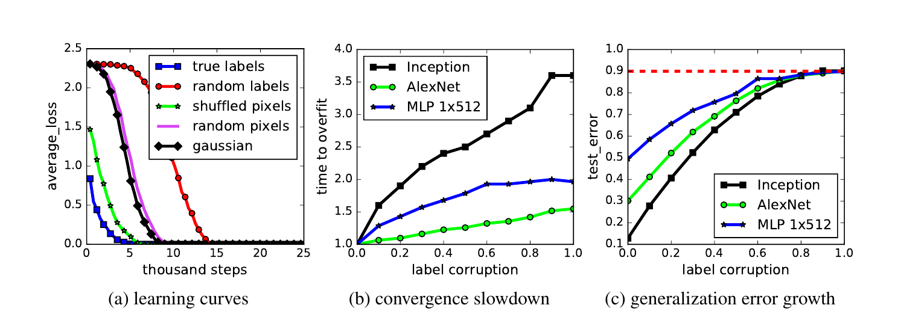
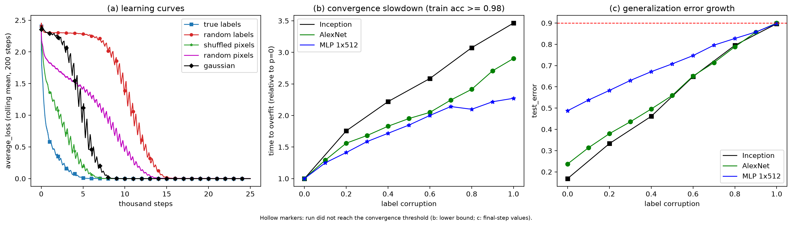

# Understanding Deep Learning Requires Rethinking Generalization (Zhang et al., ICLR 2017): reproduction of Figure 1

Preston Horne, CS 6362 Assignment 2

## 1. Problem statement and method

**Setting.** A training set $S = \{(x_i, y_i)\}_{i=1}^{n}$ with $x_i \in \mathbb{R}^d$ (CIFAR-10: $n = 50{,}000$, $28\times28\times3$ after cropping) and $y_i \in \{1,\dots,K\}$ ($K=10$). A network $f(\cdot\,; w)$ with $P$ parameters $w \in \mathbb{R}^P$, where $P \gg n$ (Inception: $P = 1.65$M; we reserve $p$ for the label-corruption probability). Training minimizes the empirical cross-entropy risk with SGD:

$$ \hat R_S(w) = \frac{1}{n}\sum_{i=1}^n \ell\big(f(x_i; w), y_i\big). $$

Measured with the 0–1 loss, the **generalization gap** is $\mathrm{err}_{test}(w) - \mathrm{err}_{train}(w)$, where the test error estimates the expected error. Once training error is 0, the test error *is* the generalization gap.

**Question.** Classical uniform-convergence bounds control the gap by a capacity measure of the hypothesis class $\mathcal{H}$ (VC dimension, Rademacher complexity
$\hat{\mathfrak{R}}_n(\mathcal{H}) = \mathbb{E}_\sigma\big[\sup_{h\in\mathcal{H}} \frac1n\sum_i \sigma_i h(x_i)\big]$,
$\sigma_i \in \{\pm1\}$ uniform, for binary $\pm1$-valued $h$), possibly helped by explicit regularization. If a network trained by SGD can fit *random* labels exactly, then $\hat{\mathfrak{R}}_n(\mathcal{H}) \approx 1$ for the class SGD actually explores. Any bound built on that capacity is then vacuous, yet the same network generalizes well on true labels. So the class capacity alone can't explain generalization.

**Randomization tests (Section 2).** Same architecture and hyperparameters; only the data changes:
- *true labels*;
- *partially corrupted labels*: independently with probability $p$, $y_i$ is replaced by a uniform draw from $\{1..K\}$;
- *random labels* ($p = 1$);
- *shuffled pixels*: one fixed permutation applied to every train and test image;
- *random pixels*: an independent permutation per image;
- *Gaussian*: pixels drawn i.i.d. from a Gaussian with the dataset's mean and variance.

**Figure 1** (CIFAR-10):
- (a) training loss vs. steps for Inception under true labels, random labels, shuffled pixels, random pixels and Gaussian;
- (b) "time to overfit" vs. $p$, relative to $p = 0$, for Inception, AlexNet and MLP 1×512;
- (c) test error after convergence vs. $p$.

**Intuition.** (a) SGD with unchanged hyperparameters drives the loss to ~0 even when there is nothing to learn. With random labels there is a plateau at $\ln 10 \approx 2.30$ (the network outputs the uniform prediction) before memorization starts. (b) The authors argue that noise slows fitting only by a constant factor (≈1.5–3.6× in their Fig. 1b), so memorizing is not much harder than learning. Critics read the same numbers differently: a 3× slowdown means early stopping would separate real from random labels (see the OpenReview comparison). (c) Test error rises smoothly toward 90% (chance), so the same model and algorithm span the range from "generalizes" to "pure memorization", depending only on the labels.

### Questions the assignment asks
- **How are random labels generated across epochs, and what would go wrong otherwise?** They are drawn **once**, before training, with a fixed seed, and reused every epoch. If they were redrawn every epoch, each example's target would be independent noise each time, the Bayes-optimal prediction would be uniform, and the loss would stay at ln 10 ≈ 2.30. Nothing could be memorized, so the experiment would show "failure to fit" for a trivial reason.
- **With corruption probability p, what fraction of labels differ, and what test error at p = 1?** A corrupted label is uniform over all 10 classes, so it hits the true class with probability 1/10. The fraction actually wrong is $0.9p$. At $p = 1$ the labels are independent of the images, so test error ≈ 90% (chance; the red dashed line in Fig. 1c). Our runs give 89.7–90.0%.
- **Optimizer, LR schedule, preprocessing, regularization:**
  - SGD with momentum 0.9.
  - Initial lr 0.1 (Inception) or 0.01 (AlexNet, MLPs), multiplied by 0.95 every epoch.
  - Preprocessing: scale to [0, 1], center-crop to 28×28, per-image whitening (TF `per_image_standardization`: subtract the image mean, divide by $\max(\sigma, 1/\sqrt{N})$).
  - No data augmentation, no weight decay, no dropout for the randomization experiments. Inception keeps BatchNorm.

### Choices we had to make
- **Convergence time (Fig. 1b):** the first logged step at which the 200-step rolling mean of minibatch training **accuracy** reaches **0.98**, divided by the same step for $p=0$ of the same architecture. We first used a loss threshold (rolling loss < τ = 0.05). It failed for the MLP: for $p \ge 0.2$ its loss never fell below 0.05 within 25k steps, because the lr has decayed to 0.95^64 ≈ 0.04× by then. Sensitivity check (`phase3_runs/figure1_b_acc_thresholds.png`): the ordering and shape are the same at 0.95 and 0.98; at 0.99 the MLP is censored for $p \ge 0.8$.
- **Grid:**
  - MLP 1×512 and AlexNet at $p \in \{0, 0.1, …, 1\}$.
  - Inception at $p \in \{0, 0.2, …, 1\}$, plus the three input corruptions (shuffled pixels, random pixels, Gaussian) for panel (a).
  - Batch size 128 (not stated in the paper; it matters because the lr decays per epoch).
  - 25k steps (the x-range of Fig. 1a).
  - One seed per point.
  - To save time, label-corruption runs stop 1000 steps after first reaching the loss threshold. This applies to all AlexNet and MLP runs that reached it, and to Inception at p ∈ {0.2, …, 0.8}. The panel (a) runs (including Inception p = 0 and p = 1) never stop early. So a "final" value below means the last logged step, not necessarily step 25k.
- **Gaussian inputs:** sampled in raw-pixel space with the training set's per-channel mean/variance, then put through the same crop and whitening.

## 2. Reproduction

**LLM:** Claude Sonnet 5.5 (Medium effort), in the claude.ai chat interface. **Conversation:** the chat ran in Claude's incognito mode, which can't be shared. With the instructor's approval (2026-10-19) we submit the full transcript ([`llm_transcript.md`](llm_transcript.md)) instead. **Code:** https://github.com/prestonmhorne/cs6362-assignment2/tree/main/zhang (`phase1.py`, `phase3.py`, notebook `reproduce_figure1.ipynb`).

*Original:*

*Reproduction:*

**(a)**
- Every Inception setting reaches ~0 training loss well within 25k steps.
- Random labels sit on the ln 10 plateau until ~7k steps and are fitted by ~15k. Paper: plateau to ~6k, fitted by ~14k.
- Ordering: true labels < shuffled pixels < Gaussian < random pixels < random labels, as in the paper. In the paper Gaussian and random pixels nearly coincide; in ours random pixels are slower (~13k vs ~8k steps), and the curve has no ln 10 plateau: it drops straight to ≈1.8.

**(b)**
- Time to overfit rises with $p$ for all three architectures: monotonically for Inception and AlexNet; the MLP has a small dip at $p = 0.8$ (2.14 → 2.10). The paper's MLP curve also flattens for $p \ge 0.6$.
- Inception reaches 3.46× at $p = 1$ (paper ≈3.6×).
- MLP reaches 2.27× (paper ≈2.0×).
- AlexNet reaches 2.90×, but the paper's AlexNet is the *flattest* curve (≈1.55×). In ours AlexNet sits above the MLP.

**(c)**
- Test error rises to 0.90 at $p = 1$ for all three.
- At $p = 0$: Inception 16.9% (snapshot) / 13.8% (final), vs Table 1 14.25%. AlexNet 23.7% vs 23.9%. MLP 48.8% vs 49.5%.
- Our curves are close to linear in $p$; the paper's are concave (fast rise at small $p$, flattening near 0.9).

**Caveat on panel (c).** Panels (b) and (c) use different convergence events. The test error plotted in (c) is a snapshot that the training code saves when the run first crosses the *loss* threshold (rolling loss < 0.05). The accuracy criterion used in (b) was added later, from the logged per-step accuracies, and test error is not logged at every step. So a snapshot at the accuracy crossing would have needed retraining. For MLP $p \ge 0.2$, which never crosses the loss threshold, (c) plots the step-25k value (hollow markers). For Inception the snapshot comes earlier than full convergence (at $p=0$, step 4200 with 2.5% train error). Its test error at the last logged step (25k for p = 0; 1000 steps after the crossing for p = 0.2) is 3–5 points lower: 13.8% / 28.5% vs 16.9% / 33.3%. For all other label-corruption runs the two values agree to within 2.2 points (largest: Inception $p=0.4$, 46.1% vs 44.0%).

### Phases, failures and corrections
**Phase 1** (`phase1.py`). The LLM's implementation was faithful on the hard details:
- All three architectures match Table 1's parameter counts exactly. For Inception this required convs without bias and BatchNorm with a shift but no scale, which the LLM inferred from the count.
- TF-style per-image standardization.
- Fixed random labels; corruption that can land on the true class (so 0.9p wrong); clean test labels.
- One permutation for shuffled pixels, a fresh permutation per image for random pixels.

Problems we found (Phase 2 review, with the MLP/AlexNet runs as evidence):
1. With the default reduced grid, the panel (a) curves stopped early instead of covering 25k steps.
2. Gaussian inputs were sampled in the *whitened* space. The paper says "matching mean and variance to the original image dataset", i.e. raw space.
3. The convergence rule (rolling loss < 0.05) was the LLM's own choice and **failed for the MLP**: for $p \ge 0.2$ the loss never got below 0.05, so panel (b) couldn't be drawn for it. The cause is the per-epoch lr decay (0.04× by 25k steps). The MLP still reached 98.85% train accuracy on random labels (Table 1: 99.34%).

**Phase 3** (`phase3_v1.py` then `phase3.py`, same chat). The final figure takes Inception from `phase3.py` runs, and MLP and AlexNet from the Phase 1 runs (`phase1_runs/`, symlinked). For the reused AlexNet/MLP label-corruption runs the training path is unchanged (smoke runs were bit-identical); Phase 3 changed only the Gaussian sampling and turned off early stopping for the panel-(a) runs.
- Change 1 (`phase3_v1.py`): early stopping off for panel (a); Gaussian inputs sampled in raw space; a τ sweep; a `panel_a` grid.
- Change 2 (`phase3.py`): an accuracy-based convergence criterion, computed from the logged per-step accuracies. This needs no retraining and leaves the training code byte-identical.

With change 2, panel (b) resolves for every run at threshold 0.98.

**Remaining differences and their likely causes:**
- AlexNet slope in (b) (ours 2.90× at p = 1, paper ≈1.55×). The choice of threshold can't explain it: accuracy thresholds 0.95–0.99 give 2.7–3.2× (`phase3_runs/figure1_b_acc_thresholds.png`), loss thresholds τ = 0.02–0.1 give 2.81–3.22× (`phase3_runs/figure1_b_thresholds.csv`), and an epoch-based definition gives the same ratio as a step-based one because the batch size is fixed. Untested: the paper's unstated batch size and AlexNet details. With the lr decaying per epoch, the batch size sets how much lr is left by the time random labels start to be fitted. Testing this means retraining the full AlexNet grid, which we did not do.
- Concavity in (c): untested. One hypothesis is that the paper's points come from longer training (its "after convergence" has no stated horizon). But our own data partly argue against it: the MLP points for $p \ge 0.2$ are already step-25k values, and they are still linear in $p$.
- Panel (a) random pixels vs Gaussian: the 200-step rolling-mean smoothing can't explain a ~5k-step shift, so we checked the logs. Our random-pixels Inception run has **34.9% test accuracy** (test error 65.1%), far above chance. Gaussian sits at chance (10.0%). A per-image pixel permutation destroys spatial structure but keeps each image's colour histogram, which likely still carries class information (we did not test a histogram-only baseline). So random pixels are a *partly learnable* task, with an immediate drop in loss and no ln 10 plateau, unlike Gaussian inputs. Why the paper's curve differs (it shows the two nearly coinciding) is untested; its random-pixel construction may differ in a detail the text doesn't state.

### Phase 4
Phase 3 code (0e0629a) and results (674bce2) were committed before Phase 4 (63069f7).

The authors never released the paper's code; the first author says it belongs to Google. The first author's demo repo, https://github.com/pluskid/fitting-random-labels, was written later from scratch with a WideResNet and an MLP (comparison in `phase4.md`). It agrees with ours on how labels are corrupted (fixed seed, uniform over all classes) and fixed across epochs. It differs from the paper (and from us) in ways where we follow the paper:
- weight decay 1e-4;
- per-channel normalization instead of per-image whitening;
- step lr decay;
- it **corrupts the test labels too**, which would measure Fig. 1c's test error against noisy labels (rising faster than 0.9p).

**No changes made.**

### Disclosures
- Web search was used **once**, after all code was written, to answer "can I share this chat even though it is incognito?" (Anthropic's support docs). No code was retrieved. The search toggle had not been turned off.
- Two details came from the LLM's background knowledge rather than the paper: TF `per_image_standardization`'s $1/\sqrt{N}$ std floor, and the LRN hyperparameters (size 9, α = 0.001/9, β = 0.75, k = 1).
- CIFAR-10 came from the Hugging Face mirror (the Toronto server was too slow). `../tools/run_patched.py` disables only torchvision's integrity check and download. The LLM's code is unmodified.
- An IDE assistant (Claude Code, Claude Opus 5.5) saved the chat's code verbatim, ran training, and drafted the review notes (`phase2_review.md`, `phase4.md`) and this report (prompts: `../claude_code_prompts.md`). It wrote only harness scripts (CIFAR-10 conversion, the md5 patch, run queues, the notebook wrapper), none of the model, training or plotting code.
- The critical review and OpenReview comparison (Section 3) were drafted and condensed with Claude Code (an IDE assistant) from our reproduction results and the saved OpenReview reviews; the prompts are in `../claude_code_prompts.md`.

## 3. Critical review

**Summary of claims.** With unchanged hyperparameters, SGD fits random labels, permuted pixels and Gaussian noise on CIFAR-10, and random labels slow training "only by a small constant factor". So VC dimension, Rademacher complexity and uniform stability can't explain generalization.

**Strengths.**
- *Only the labels change.* Model, optimizer and schedule are fixed, so the jump from 14–50% test error on true labels to 90% on random labels comes from the labels alone.
- *It reproduces.* With Appendix A's hyperparameters and no tuning, our Inception and AlexNet runs fit every corruption level. Random labels sit on the ln 10 plateau until ~7k steps (paper ~6k). Test error at p = 1 is 89.7–90.0%. AlexNet and MLP test errors at p = 0 are within a point of Table 1.
- *It became a standard test* for later bounds (Bartlett et al., 2017; Neyshabur et al., 2017; Dziugaite & Roy, 2017).

**Weaknesses and potential errors.**
1. *The paper's "rule out" overstates the evidence.* The experiment shows that data-independent, class-level bounds are vacuous for the networks SGD reaches. Section 2.2 concedes that data-dependent notions exist, and within a year data-dependent bounds separated true from random labels (the three papers above).
2. *The slowdown is a form of capacity control.* Our Fig. 1b gives 3.46× (Inception), 2.90× (AlexNet) and 2.27× (MLP) at p = 1. At step 4100, when the true-label Inception and AlexNet runs reach 98% training accuracy, their random-label runs are at 13% and 18% (chance is 10%). A budget enough for real labels is not enough for random ones. The MLP is the exception: at its true-label convergence step (9200), its random-label run is already at 73%.
3. *The text rounds up its own tables.* Section 2.1 says the networks fit the corrupted set "perfectly for all the cases", but Table 1 gives 99.82% (AlexNet) and 99.34% (MLP 1×512) on random labels. Our MLP stops at 98.85%. And despite the abstract's "qualitatively unaffected by explicit regularization", AlexNet with weight decay "fails to converge" (Sec. 3).
4. *Random pixels are not a noise control.* Inception on per-image-permuted pixels with true labels reaches 34.9% test accuracy (Gaussian: 10.0%), likely because a permutation keeps each image's colour histogram. Its curve has no ln 10 plateau and fits later than Gaussian (~13k vs ~8k steps), while the paper's two curves nearly coincide.
5. *Figure 1 is under-specified.* "Time to overfit" is undefined, the batch size and "after convergence" horizon are missing, and each point is one run. Our AlexNet slowdown is 2.7–3.2× at every accuracy threshold from 0.95 to 0.99, against the paper's ≈1.55×. Our test-error curves are close to linear in p; the paper's are concave. The numbers behind "small constant factor" can't be checked.
6. *The positive explanation is thin.* Section 5's minimum-norm argument is undercut by its own MNIST result: wavelet preprocessing raises the norm from ≈220 to ≈390 while test error halves.

**Overall.** The experiment is sound and reproduces. The weaknesses are in the inferences and in an under-specified Figure 1.

### Comparison with the OpenReview reviews (https://openreview.net/forum?id=Sy8gdB9xx)

**Decision:** Accept (Oral). Official ratings: R3 10, R2 9, R1 10.

**Where we agree.** R1 and R3 say the paper doesn't explain generalization (our point 6). T. Dietterich's public comment reads Fig. 1 as ~5k steps on true labels versus >13k on random labels, and argues that early stopping at 5k steps would give a non-trivial Rademacher complexity. This is our point 2. Xiang Zhang (who called the Rademacher argument "a bit hand-waving") and B. Neyshabur, arguing that generalization comes from the optimizer rather than class capacity, make our point 1 from the theory side.

**What they raised that we didn't.** G. Yang argued that the VC-dimension sentence in the reviewed version's Section 2.2 confuses fitting a sample with error on the distribution. Commenters on Section 5 noted that the minimum-norm property comes from the zero initialization, not specifically from SGD, and that the MNIST result needs an RBF kernel the paper doesn't name. Others asked for random-label results with data augmentation, and the authors added Appendix E in response. R1 asked why architectures with equal parameter counts generalize differently. R3 asked about the surrogate loss, Theorem 1 under finite precision, and one-vs-all targets.

**What we raised that they didn't.** No one questioned Figure 1's protocol (point 5), noticed that random pixels keep class signal (point 4), or checked the text against Table 1 (point 3). Point 2 extends Dietterich's critique by measuring the random-label runs at the true-label convergence step, which also turns up the MLP exception.

**Calibration.** The official reviews are short, and the technical scrutiny came from public commenters. R2's "complete accord" accepts the "rule out" claim we think goes too far. We would have given an 8 (clear accept) and asked for a defined Figure 1 protocol with several seeds and a narrower "rule out" claim.

### References
- Bartlett, P., Foster, D., Telgarsky, M. (2017). Spectrally-normalized margin bounds for neural networks. NeurIPS.
- Dziugaite, G. K., Roy, D. M. (2017). Computing nonvacuous generalization bounds for deep (stochastic) neural networks with many more parameters than training data. UAI.
- Neyshabur, B., Bhojanapalli, S., McAllester, D., Srebro, N. (2017). Exploring generalization in deep learning. NeurIPS.
